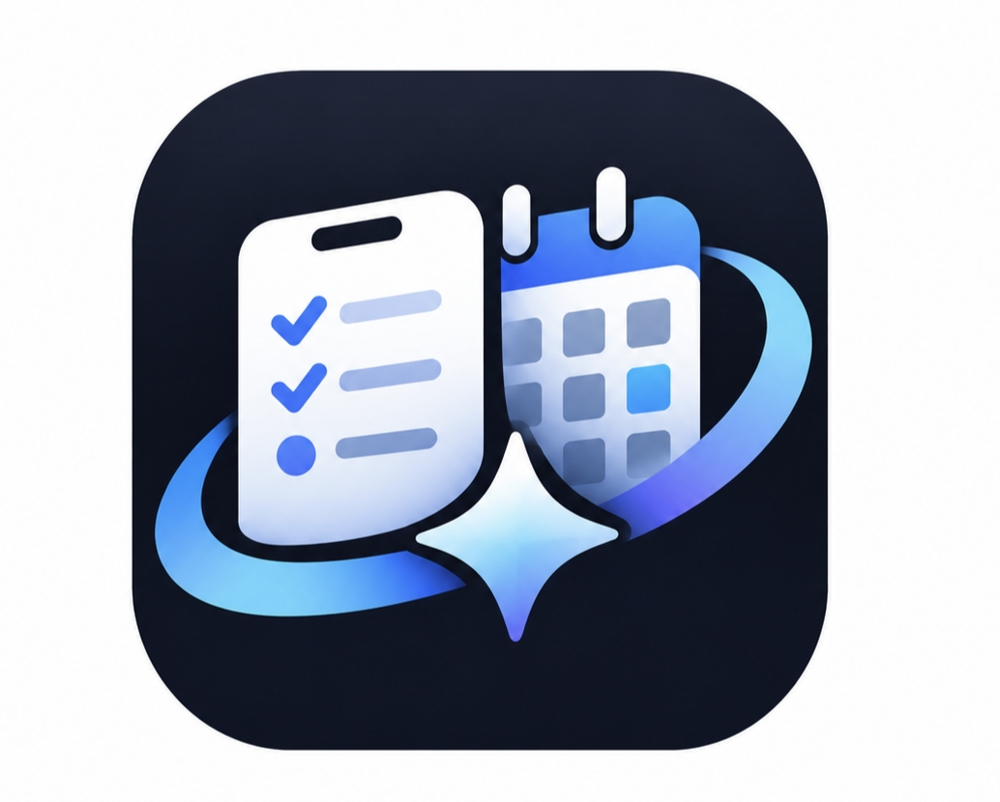
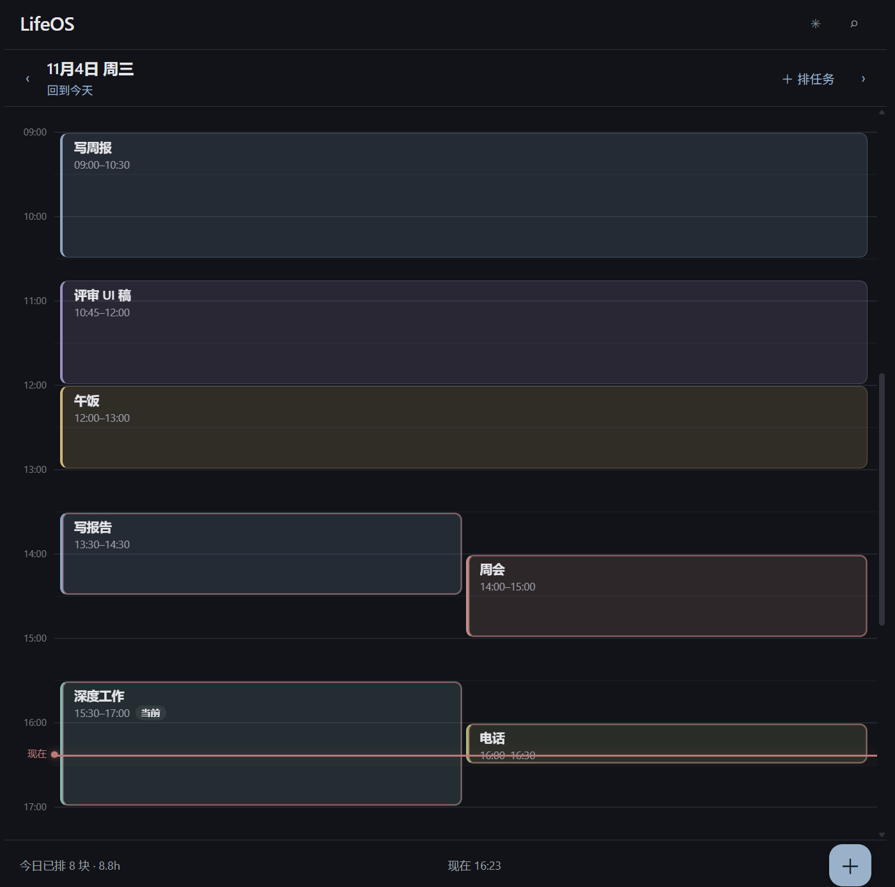
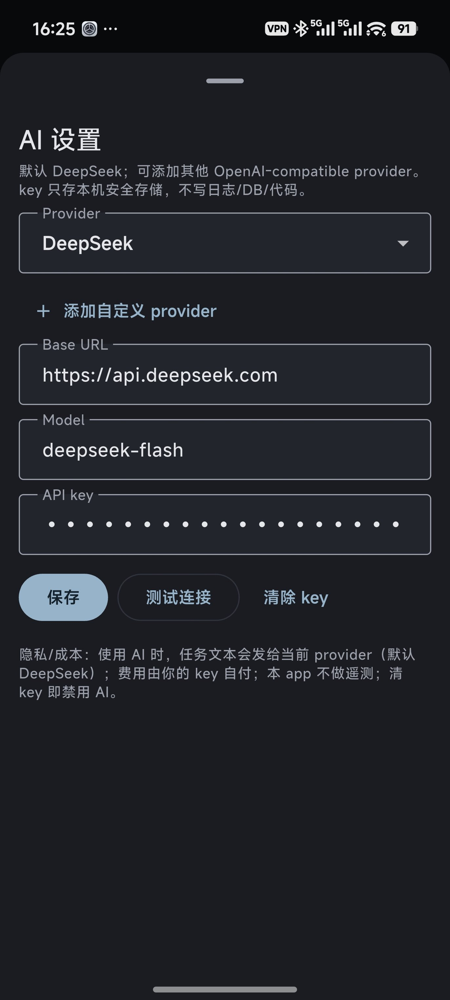
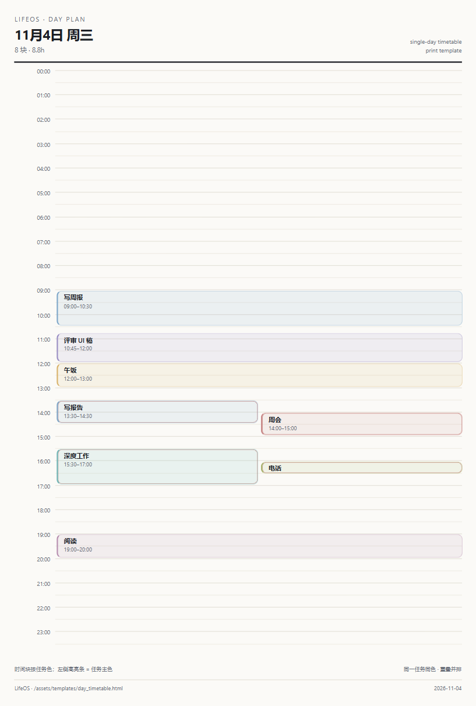

# LifeOS

<p align="center">
  
</p>

<p align="center">
  A phone-first task + light-note app, built around a single idea: capture and plan on the phone, do the work somewhere else.
</p>

<p align="center">
  <a href="https://github.com/ZileiC/lifeos/actions/workflows/ci.yml"></a>
  <a href="LICENSE"></a>
  
  
</p>

English | [中文](README.zh-CN.md)

## Status

Stage 1 is in a 14-day field test: AI day-plan suggestions vs manual planning. The app is not on any store; the APK is built from `main` and installed directly. Rough edges are expected — the UI is a first pass.

## What it is

- Capture a task in seconds: title, urgency/importance (1–10), deadline, estimate, and an optional weekly-fixed pattern.
- Plan a day as time slices on a 24-hour grid. The phone plans; it does not record completion.
- Ask the AI to propose a day plan (suggestion only — you confirm every block) or answer questions like "can I finish this today", "how should I plan today", "am I free at 3".
- Print a day as an A4 sheet, or hand the same layout to an Obsidian plugin.

The core product decision is C′: the phone is the capture/plan/availability surface; the real working environment is Obsidian. This repository contains the phone app and the shared scheduling contract/skill; the Obsidian plugin is separate.

## Screenshots

| Day grid | AI settings |
|---|---|
|  |  |

| A4 print template |
|---|
|  |

The ask-AI and suggestion dialogs are not shown here yet.


## Design

The design is intentionally quiet: one dark theme, muted colors, no neon. A few rules that shape everything:

- **U&I are raw 1–10 scores.** The phone stores the numbers as entered; an Obsidian U/I scatter uses the same values later. The app does not rewrite them.
- **One task, one color.** Every slice of a task keeps the task's color; the day grid and the print template share the same palette.
- **The day grid is the plan, not a checklist.** A slice is a planned block; completion lives in Obsidian.
- **Weekly-fixed tasks are templates.** Changing a template does not silently rewrite already-generated slices.
- **AI is a copilot.** Every suggestion is validated (`taskId` must exist, no past blocks, no cross-day blocks, conflicts flagged, over-allocation warned) and written only after an explicit confirm. Q&A is read-only.

The current day grid mirrors a calendar-style 24h layout: hour lines, a red "now" line, time blocks with a left color bar, and overlapping blocks laid out side by side. The A4 template reuses the same tokens on paper.

## Features

### Shipped (Stage 0)

- Task capture with U&I 1–10, deadline, estimate, weekly-fixed tasks.
- Day slices on a 24h time grid; add/edit/delete a slice.
- Weekly-fixed tasks generate same-color slices across the chosen weekdays and date range.
- Batch delete / move to a day, with single-step undo.
- Dark theme only; no completion state on the phone; no reminders or system calendar.

### In field test (Stage 1)

- **AI day-plan suggestions**: propose slices for a day, preview them on the grid as dashed blocks, confirm/edit/ignore. Nothing is written automatically.
- **Ask AI**: read-only Q&A over tasks, slices, weekly-fixed items, DDLs, estimates and the current time; the last 5 turns are kept in memory. An answer that contains a plan can be routed into the same suggestion/confirm flow.
- **Provider choice**: DeepSeek by default (`deepseek-flash`, switchable to `deepseek-v4-pro`), plus any custom OpenAI-compatible provider (base URL, model, key).
- **A4 print template** for a day, sharing the phone's visual tokens.

## AI

- The API key is entered in the app, stored per provider in Android Keystore via `flutter_secure_storage`, and never written to logs or committed.
- The request context is tasks, existing slices for the target day, the next 7 days, and the current time. Task notes are not sent by default.
- The scheduling rules live in `assets/skill/scheduling.md` (v2). It is the shared skill: the phone copy and the Obsidian canonical copy are kept identical.
- Model calls are plain OpenAI-compatible chat completions with a strict JSON contract; the app owns parsing and validation.

## Architecture

```
lib/
  ai/          provider config, OpenAI-compatible client, prompts, validator, schedule/Q&A services
  data/        Drift tables, migrations, repositories, recurrence, task colors
  ui/          screens, sheets, the day grid
  providers.dart
assets/
  skill/       the shared scheduling skill (v2)
  templates/   A4 print template + sample day JSON
docs/          product docs, print contract, design preview
test/          unit + widget tests (analyze and test are the merge gate)
```

- Flutter + Drift (SQLite) + Riverpod; one codebase for Android and Windows.
- UUID primary keys, `createdAt`/`updatedAt`, tombstone deletes (`deletedAt`).
- The AI layer is separated from the UI so it can be tested without a network: the client, the validator and both services are covered by fake-client tests.

## Build

```bash
flutter pub get
flutter run -d windows      # desktop preview (developer mode enabled for symlinks)
flutter build apk --release # Android APK
flutter analyze
flutter test
```

No key is needed at build time. The user enters the AI key inside the app. The current release APK is signed with the project's debug key for personal installs; a production signing setup and a signed CI release are on the roadmap.

## Roadmap

- Finish the Stage 1 field test and write the result.
- Improve the app's overall visual design (the day grid is the first pass, not the final look).
- Production signing + signed APK releases.
- The Obsidian plugin (separate repository) that consumes the same contract and skill.
- Later, and only if the field test supports it: calendar/notifications integration.

## Limitations

- The phone does not track completion by design.
- AI usage costs money and sends task text to the chosen provider; the key and the bill are the user's.
- No system calendar, widgets or notifications in this stage.
- Android and Windows only. No iOS.

## Contributing

See [CONTRIBUTING.md](CONTRIBUTING.md). Security reports: see [SECURITY.md](SECURITY.md). By participating you agree to the [Code of Conduct](CODE_OF_CONDUCT.md).

## License

[MIT](LICENSE) © 2026 ZileiC
