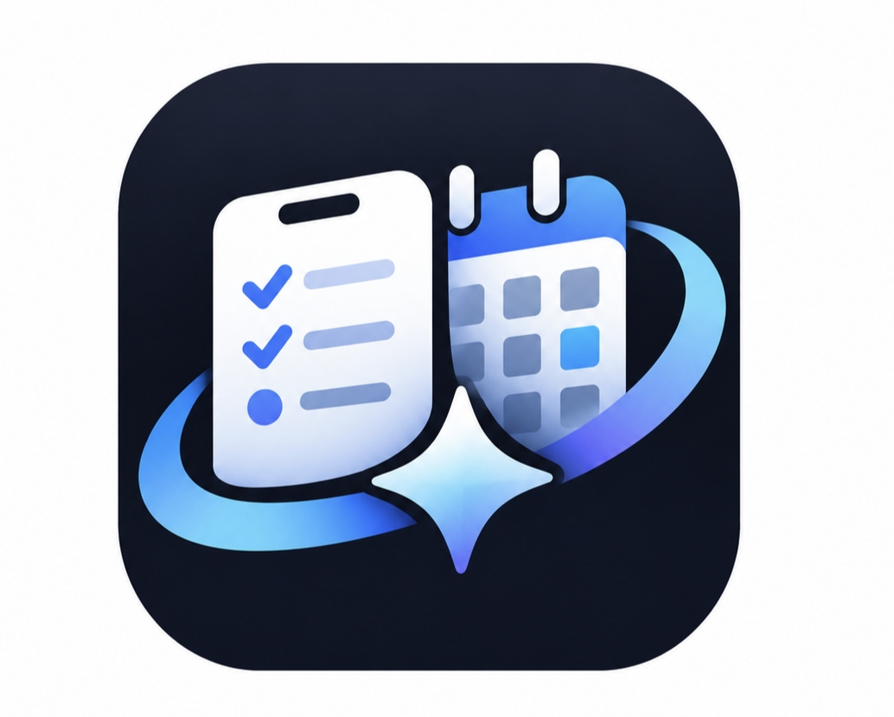
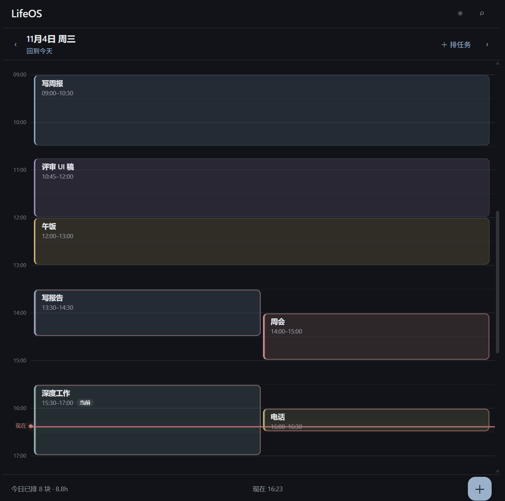
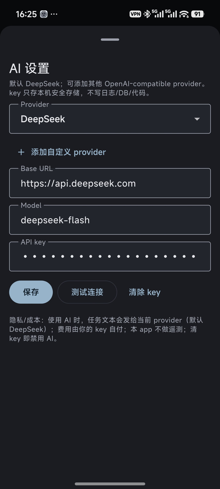
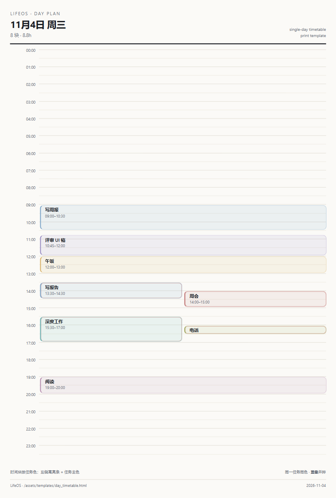

# LifeOS

<p align="center">
  
</p>

<p align="center">
  手机优先的「任务 + 轻记录」app，只围绕一件事：在手机上捕获与安排，真正干活在别处。
</p>

<p align="center">
  <a href="https://github.com/ZileiC/lifeos/actions/workflows/ci.yml"></a>
  <a href="LICENSE"></a>
  
  
</p>

[English](README.md) | 中文

## 当前状态

Stage 1 正在做 14 天实地实验：AI 日计划建议 vs 手动排程。app 没有上架，APK 直接构建自 `main` 安装。会有粗糙的地方——UI 目前是第一版。

## 它是什么

- 几秒钟记下一个任务：标题、U&I（1–10）、ddl、预估、可选的每周固定。
- 在 24h 时间网格上把一天排成时间片。手机只负责排，不负责记完成。
- 让 AI 给当天排程建议（只是建议，每一块都要你确认），或回答「今天来不来得及」「今天怎么排」「下午三点有空吗」。
- 把一天打印成 A4 日程表，或把同一份布局交给 Obsidian 插件。

核心产品决策是 C′：手机 = 捕获 / 排程 / 可用性问答；真正的干活环境是 Obsidian。本仓库包含手机 app 和共享的排程契约/skill；Obsidian 插件是独立仓库。

## 截图

| 单日网格 | AI 设置 |
|---|---|
|  |  |

| A4 打印模板 |
|---|
|  |

问 AI / AI 建议的弹窗截图暂时没放。


## 设计

整体是克制的：只有一个深色主题、低饱和颜色、没有霓虹。几条规则决定了所有细节：

- **U&I 是原始 1–10 分。** 手机按原值保存；以后 Obsidian 的 U/I 散点图用同一组数值。app 不改写用户的分数。
- **一个任务一个颜色。** 任务的所有日片保持同一颜色；单日网格和打印模板共用同一组色板。
- **日网格是计划，不是打卡。** 一个片是计划块；完成只发生在 Obsidian。
- **每周固定是模板。** 改模板不会悄悄重写已经生成的日片。
- **AI 是副驾。** 每条建议都会校验（taskId 必须存在、不能排到过去、不能跨天、冲突提示、超额提示），只有明确确认后才写入。问答是只读的。

当前单日网格是日历式布局：24h 时间轴、小时线、红色「现在」线、左侧色条的时间块、重叠块并排。A4 模板把同一套 token 换到纸面上。

## 功能

### 已交付（Stage 0）

- 任务捕获：U&I 1–10、ddl、预估、每周固定。
- 24h 时间网格上的日片；增/改/删单个日片。
- 每周固定任务在选定的星期与日期范围内生成同色日片。
- 批量删除 / 移到某天，单步撤销。
- 只有深色主题；手机端没有完成状态；没有提醒和系统日历。

### 实地实验中（Stage 1）

- **AI 排程建议**：为目标日生成日片，以虚线块预览在网格上，确认/编辑/忽略。不自动写入。
- **问 AI**：基于任务、日片、每周固定、ddl、预估和当前时间做只读问答；最近 5 轮保留在内存里。回答里带排程时，可以转入同一套建议/确认流程。
- **Provider 可选**：默认 DeepSeek（`deepseek-flash`，可切 `deepseek-v4-pro`），也可以添加任意 OpenAI-compatible provider（base URL / model / key）。
- **A4 打印模板**：与手机日视图共用视觉 token。

## AI

- API key 在 app 内输入，按 provider 存 Android Keystore（`flutter_secure_storage`），不进日志、不进仓库。
- 请求上下文：任务、目标日已有日片、未来 7 天、当前时间。默认不发送任务备注。
- 排程规则在 `assets/skill/scheduling.md`（v2）；手机副本与 Obsidian canonical 副本保持一致。
- 模型调用是标准 OpenAI-compatible chat completions + 严格 JSON 契约；解析和校验由 app 负责。

## 结构

```
lib/
  ai/          provider 配置、OpenAI-compatible 客户端、prompt、validator、排程/问答服务
  data/        Drift 表、迁移、仓库、每周规则、任务颜色
  ui/          页面、sheet、单日网格
  providers.dart
assets/
  skill/       共享排程 skill（v2）
  templates/   A4 打印模板 + sample day JSON
docs/          产品文档、打印契约、设计预览
test/          单元 + widget 测试（analyze/test 是合并门槛）
```

- Flutter + Drift (SQLite) + Riverpod；一套代码跑 Android 和 Windows。
- UUID 主键、`createdAt`/`updatedAt`、墓碑删除（`deletedAt`）。
- AI 层与 UI 分离，可离线测试：客户端、validator、两个 service 都有 fake-client 测试。

## 构建

```bash
flutter pub get
flutter run -d windows      # 桌面预览（需开启开发者模式以支持 symlink）
flutter build apk --release # Android APK
flutter analyze
flutter test
```

构建期不需要任何 key；AI key 由用户在 app 内填写。当前 release APK 使用项目 debug key 签名，仅供个人安装；正式签名和带签名的 CI release 在路线图上。

## 路线图

- 完成 Stage 1 实地实验并归档结论。
- 整体 UI 升级（日网格只是第一版，不是最终视觉）。
- 正式签名 + 签名的 APK release。
- Obsidian 插件（独立仓库），消费同一份契约与 skill。
- 只有在实验支持时才考虑：系统日历/通知集成。

## 限制

- 手机端按设计不记录完成。
- AI 会花钱，且会把任务文本发给你选择的 provider；key 和账单都由用户承担。
- 本阶段没有系统日历、小组件、通知。
- 只支持 Android 和 Windows，没有 iOS。

## 参与

见 [CONTRIBUTING.md](CONTRIBUTING.md)。安全问题见 [SECURITY.md](SECURITY.md)。参与即表示同意 [行为准则](CODE_OF_CONDUCT.md)。

## License

[MIT](LICENSE) © 2026 ZileiC
